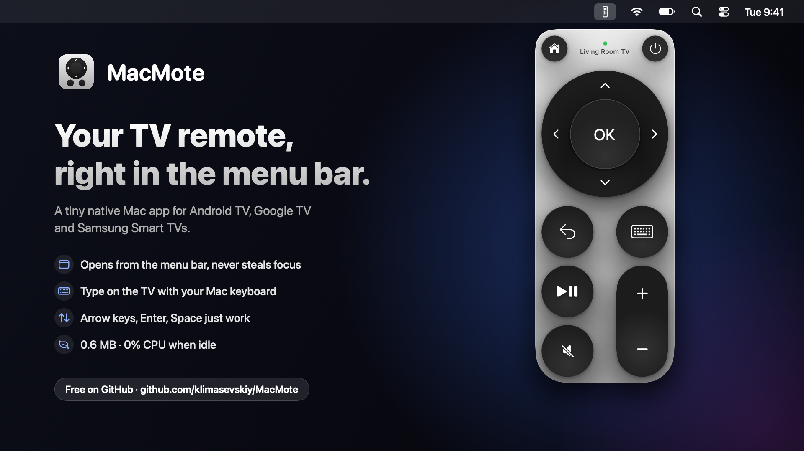
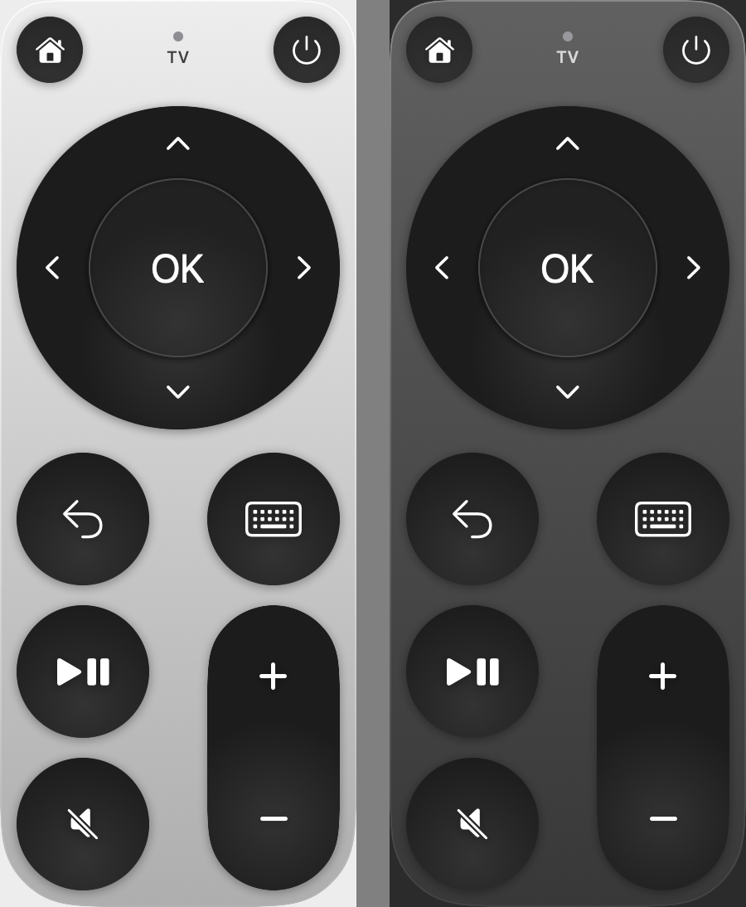

<p align="center"></p>

<h1 align="center">MacMote</h1>

<p align="center">
  A tiny menu bar remote for <b>Android TV / Google TV</b> and <b>Samsung Tizen</b> TVs on macOS.
</p>

<p align="center"><b>English</b> · <a href="README.uk.md">Українська</a></p>

<p align="center"></p>

## Features

- **Lives in the menu bar.** Click the icon to open the remote. It never steals focus from the app you're using.
- **Android TV and Samsung.** MacMote finds both kinds of TV on your network automatically. If there are several, pick one in the remote or under right-click → **Телевізор** (TV).
- **Type with your Mac keyboard.** The ⌨ button (or `K`) opens a text field. What you type shows up on the TV instantly (any language), and `Enter` submits the search.
- **Keyboard control** while the remote is open:

  | Key | Action |
  |---|---|
  | `↑ ↓ ← →` | navigate |
  | `Enter` | OK |
  | `⌫` | back |
  | `Space` | play / pause |
  | `H` | home |
  | `M` | mute |
  | `+` / `−` | volume |
  | `K` | keyboard |
  | `Esc` | close the remote |

- **Press and hold** the arrows or volume to repeat.
- **Wake-on-LAN.** The power button wakes the TV from sleep (after the first connection).
- **Light / dark mode**, VoiceOver support, launch at login.
- **Lightweight.** Native Swift with no dependencies, a ~0.6 MB binary, and 0% CPU when idle. The TV connection closes 90 s after you close the remote, and the UI is unloaded from memory.

## Requirements

- macOS 15 Sequoia or later (Apple Silicon or Intel)
- A TV on the same network:
  - **Android TV / Google TV** with the Android TV Remote Service. That covers every modern Google TV, Chromecast with Google TV, Sony, TCL, Philips and others.
  - **Samsung Smart TV on Tizen** (2016 and newer).

## Installation

1. Download `MacMote.zip` from [Releases](../../releases), unzip it and move `MacMote.app` to Applications.
2. The app is ad-hoc signed (no Apple Developer ID). On first launch, **right-click → Open**, or run:
   ```bash
   xattr -dr com.apple.quarantine /Applications/MacMote.app
   ```
3. Allow **Local Network** access when macOS asks.
4. Click the remote icon and pair once:
   - **Android TV:** a 6-character code appears on the TV. Enter it in the remote.
   - **Samsung:** the TV asks whether to allow MacMote. Choose **Allow**.

   MacMote connects automatically from then on.

On Samsung, Wake-on-LAN needs **Power On with Mobile** turned on in the TV's settings.

## Building from source

You only need the Xcode Command Line Tools (`xcode-select --install`).

```bash
./build.sh        # build/MacMote.app
./build.sh zip    # + build/MacMote.zip for a release
```

To regenerate the icon, run `swift scripts/make-icon.swift`. The promo banners in `docs/` come from `scripts/make-banner.swift` (the build command is at the top of the file).

## How it works

**Discovery** runs both searches at once: Bonjour (`_androidtvremote2._tcp`) for Android TVs, and SSDP followed by a check of `http://<ip>:8001/api/v2/` for Samsung.

**Android TV / Google TV** uses the same protocol as the official Google TV phone app (**Android TV Remote v2**):

- **Pairing:** TLS on port `6467`. MacMote generates a client certificate once (stored in `~/Library/Application Support/MacMote`). The code shown on the TV confirms a SHA-256 hash of both sides' public keys.
- **Control:** TLS on port `6466`, using protobuf messages with Android key codes. Text goes through IME batch edits.

**Samsung Tizen** uses the SmartView WebSocket API:

- **Pairing:** the first connection to `wss://<ip>:8002/api/v2/channels/samsung.remote.control` shows the Allow prompt. The TV then returns a token that MacMote stores for later connections.
- **Control:** JSON `ms.remote.control` messages carrying `KEY_*` codes. Text is sent with `SendInputString`.

| File | Contents |
|---|---|
| `Sources/main.swift` | menu bar item, panel, keyboard shortcuts |
| `Sources/RemoteView.swift` | remote UI (SwiftUI) |
| `Sources/TVClient.swift` | TV selection, reconnects, key mapping, Wake-on-LAN |
| `Sources/Discovery.swift` | Bonjour and SSDP search |
| `Sources/AndroidTV.swift` | Android TV Remote v2 protocol |
| `Sources/SamsungTV.swift` | Samsung SmartView protocol |
| `Sources/Identity.swift` | client certificate and RSA keys (Android TV) |
| `Sources/Proto.swift` | minimal protobuf codec (Android TV) |

## Resetting the pairing

Right-click the icon → **Pair with TV again**.

## Author

© 2026 klimasevskiy
