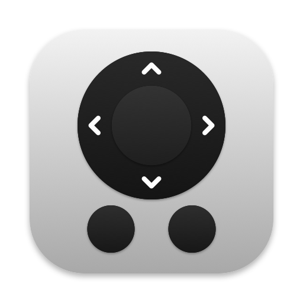
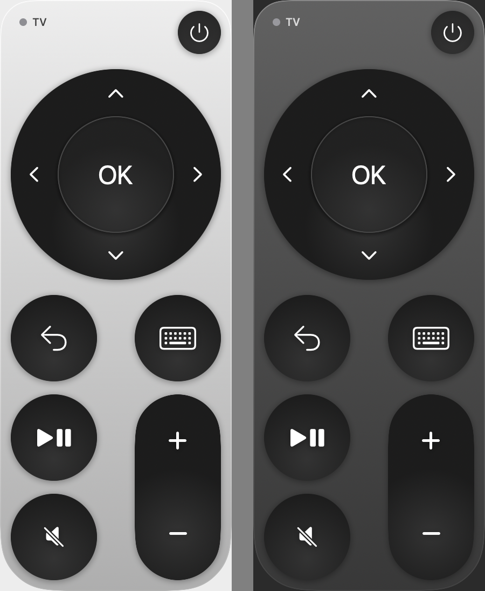

<p align="center"></p>

<h1 align="center">MacMote</h1>

<p align="center">
  Легкий пульт для <b>Android TV / Google TV</b> у рядку меню macOS.
</p>

<p align="center"><a href="README.md">English</a> · <b>Українська</b></p>

<p align="center"></p>

## Можливості

- **Пульт у рядку меню** — клік по іконці відкриває пульт; він не забирає фокус в активної програми.
- **Набір тексту з клавіатури Mac** — кнопка ⌨ (або `K`) відкриває поле, текст одразу з'являється на TV (кирилиця теж), `Enter` — відправити пошук.
- **Керування клавішами**, поки пульт відкритий:

  | Клавіша | Дія |
  |---|---|
  | `↑ ↓ ← →` | навігація |
  | `Enter` | OK |
  | `⌫` | назад |
  | `Space` | відтворення / пауза |
  | `H` | головний екран |
  | `M` | без звуку |
  | `+` / `−` | гучність |
  | `K` | клавіатура |
  | `Esc` | закрити пульт |

- **Утримання** стрілок і гучності повторює натискання.
- **Wake-on-LAN** — кнопка живлення будить TV зі сну (після першого підключення).
- **Світла / темна тема**, VoiceOver, «Запускати при вході».
- **Легкість** — нативний Swift без залежностей, бінарник ~0.6 МБ, у простої 0% CPU. З'єднання з TV закривається через 90 с після закриття пульта, інтерфейс вивантажується з пам'яті.

## Вимоги

- macOS 15 Sequoia або новіша (Apple Silicon або Intel)
- Android TV / Google TV з підтримкою Android TV Remote Service (усі сучасні TV з Google TV, Chromecast with Google TV, Sony, TCL, Philips тощо) у тій самій мережі

## Встановлення

1. Завантаж `MacMote.zip` з [Releases](../../releases), розпакуй і перенеси `MacMote.app` у «Програми».
2. Програма підписана ad-hoc (без Apple Developer ID), тож при першому запуску: **правий клік → Відкрити**, або:
   ```bash
   xattr -dr com.apple.quarantine /Applications/MacMote.app
   ```
3. Дозволь доступ до **локальної мережі**, коли macOS запитає.
4. Клікни іконку пульта → на TV з'явиться 6-значний код → введи його. Готово, далі підключення автоматичне.

## Збірка з вихідного коду

Потрібні лише Xcode Command Line Tools (`xcode-select --install`).

```bash
./build.sh        # build/MacMote.app
./build.sh zip    # + build/MacMote.zip для релізу
```

Іконку перегенерувати: `swift scripts/make-icon.swift`.

## Як це працює

MacMote говорить тим самим протоколом, що й офіційний застосунок Google TV на телефоні (**Android TV Remote v2**):

- Пошук TV через Bonjour (`_androidtvremote2._tcp`).
- **Сполучення** — TLS на порту `6467`: клієнтський сертифікат (генерується один раз, `~/Library/Application Support/MacMote`) і код з екрана TV, що підтверджує SHA-256 від публічних ключів обох сторін.
- **Керування** — TLS на порту `6466`, protobuf-повідомлення з кодами клавіш Android, текст — через IME batch edit.

| Файл | Що всередині |
|---|---|
| `Sources/main.swift` | рядок меню, панель, клавіатурні скорочення |
| `Sources/RemoteView.swift` | інтерфейс пульта (SwiftUI) |
| `Sources/TVClient.swift` | пошук, сполучення, протокол керування, Wake-on-LAN |
| `Sources/Identity.swift` | клієнтський сертифікат і RSA-ключі |
| `Sources/Proto.swift` | мінімальний protobuf-кодек |

## Скинути сполучення

Правий клік по іконці → **Сполучити з TV заново**.
